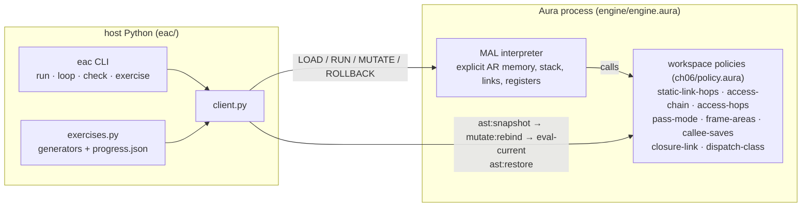

# aura-eac

**《Engineering a Compiler》（Cooper & Torczon）的 Aura 学习助手。** 书里讲的运行时机制，在这里变成可以运行、可以观察、可以热修改的实验。

Aura 是一个可以修改自身的运行时。本仓库把"编译器作者要做的决定"写成 Aura 工作区里的普通 `define`。第 6 章是运行时约定：静态链怎么建立、参数怎么传、AR 怎么布局、谁来保存寄存器、方法怎么分派。第 7 章是代码形态：先算哪个操作数、布尔值怎么编码、数组怎么布局和寻址、case 用哪种实现。学习者或驱动脚本可以：
- 用 `mutate:rebind` 换掉其中一条约定，再用 `eval-current` 让它立即生效；
- 重新运行同一个程序，查看每个活动记录里的字段；
- 用 `ast:snapshot` / `ast:restore` 回到已知正确的版本，并且源码保证逐字节恢复。

练习题按种子生成，**答案由引擎实际运行得出**，不是手写的答案表。进度文件记录哪些概念已经掌握、哪些容易混淆（例如把静态链和动态链搞混），下一题会针对薄弱点出。

> 版权说明：本仓库不包含书中的文字或图。讲解和例子都是原创的，只引用节号（按第 3 版）。

## 结构

- `engine/engine.aura`：MAL 的解释器和协议服务器。MAL 是一个很小的 Algol 风格语言，支持嵌套过程、全局变量、`while`、过程参数、寄存器和类。所有变量都放在显式的 AR 存储里，按 ⟨AR, 偏移⟩ 寻址。静态链、动态链和返回地址都是真实的槽位，缺了某个槽位就会以"链接错误"的形式表现出来。
- `ch06/policy.aura`：第 6 章的约定（v0），放在工作区里，可以随时变异。
- `engine/codeshape.aura` + `ch07/`：第 7 章。源语言到类 ILOC 三地址码的生成器（虚拟寄存器按栈分配）、执行生成代码的 ILOC 解释器，以及判断代码是否算对的参考解释器。代码形态的选择都在 `ch07/policy.aura` 里，见 [ch07/README.md](ch07/README.md)。
- `ch06/labN-*/`：每个 lab 包含 `program.mal`、`lab.json`（检查项和命名变异）以及 `LESSON.md`（中文讲解和英文摘要）。
- `eac/`：宿主端代码，包括 CLI、lab 运行器、渲染器、练习生成器和进度文件。
- `tests/`：单元测试和 lab 测试，覆盖全部检查项、每个变异的闭环、练习自检和薄弱点定向。

## 快速开始
```bash
export AURA_BIN=/path/to/aura/build-rel/aura      # Aura main >= c8ad457c9 (pinned here: c8ad457c9)
scripts/in-docker.sh 'python3 -m eac labs'
scripts/in-docker.sh 'python3 -m eac check'                                      # 52 checks (ch06: 24, ch07: 28)
scripts/in-docker.sh 'python3 -m eac loop ch06/lab2-static-links link-to-caller'  # minimal loop
scripts/in-docker.sh 'python3 -m eac run ch06/lab3-parameter-passing -m all-name --trace'
scripts/in-docker.sh 'python3 -m eac exercise next'       # then: exercise answer <id> <answer>; exercise status
scripts/in-docker.sh 'python3 -m eac loop ch07/lab1-eval-order reorder-across-effects'   # ch07 minimal loop
scripts/in-docker.sh 'python3 -m eac run ch07/lab1-eval-order --code'                    # emitted ILOC + stats
scripts/in-docker.sh 'python3 -m eac addr ch07/lab3-arrays A 2 3 -m column-major'
scripts/in-docker.sh 'python3 -m eac --chapter ch07 exercise next'                       # chapter 7 exercises only
scripts/test.sh --docker
```
`scripts/in-docker.sh` 在 `ghcr.io/cybrid-systems/dev:v1.0.9` 里运行，内存上限 4 GB，并设置 `AURA_SANDBOX=off AURA_PIPELINE_STRICT=0`。

## 最小闭环示例（lab2，静态链改成指向调用者）
```
== 1. correct convention                       == 2. static-link-hops := (lambda (c e) 0)
  #3 q  (level 2)                                 #3 q  (level 2)
      [2] static   1  -> AR #1 (main)                 [2] static   2  -> AR #2 (p)
output: [7, 8, 9]                               output: [100, 7, 8]      ← r 静默读到了 p 的 x
== 3. ast:restore + eval-current  source restored byte-for-byte: True   output: [7, 8, 9]
```

## 路线图
| 章（第 3 版） | 计划中的 lab | 工作区里可变异的部分 |
|---|---|---|
| **6 过程的实现** | ✅ AR、静态链与动态链、参数传递、链接约定、过程参数、对象记录 | 见上 |
| **7 代码形态** | ✅ 求值顺序与寄存器需求、布尔值的数值编码与位置编码及短路、数组寻址（行主序、列主序、间接向量、dope vector、下标检查）、`case` 的三种实现 | 见 [ch07/README.md](ch07/README.md) |
| 5 语法制导翻译 | 属性求值；把 MAL 翻译成三地址码 | 翻译规则 |
| 4 中间表示 | AST、DAG、三地址码之间互相转换，SSA 构造 | IR 选择、命名规则 |
| 8–10 优化与数据流分析 | 局部值编号、活跃变量、到达定义、迭代求解器 | 转移函数、合流运算 |
| 11–13 后端 | 树模式指令选择、表调度、图着色寄存器分配 | 代价函数、优先级、溢出启发式 |
| 2–3 前端 | 正则式到 DFA、LL(1) / LR(1) 表构造 | 文法、冲突处理策略 |

## 已知的 Aura 问题（本仓库发现或用到）
| issue | 现象 | 本仓库的做法 |
|---|---|---|
| cybrid-systems/aura#4587 | 工作区 define 引用未绑定的名字或宿主的非过程全局变量时，静默得到 `0`；运行时能调用宿主过程，但变异后的类型检查又说它未绑定 | 策略都写成只依赖参数的纯函数 |
| cybrid-systems/aura#4588（已补充评论） | `let` 初始化表达式里抛出的 `error` 被当成值绑定，`let` 体照常执行。普通脚本里也会这样 | 引擎所有错误都经过 `fail`，它会记下一个"粘滞"错误：之后的写操作全部跳过，`tick!` 重新抛出；工作区策略调用都包在 try 里 |
| cybrid-systems/aura#4583 / #4584 | 工作区里有自递归 define 时 rebind 会膨胀；工作区里用 filter/map 会导致错误分派 | 工作区里不用递归，也不用 filter/map |
| cybrid-systems/aura#4575 | Soft 级沙箱拦截 set-code 和 mutate | `AURA_SANDBOX=off`，所以只在容器里、只处理可信输入时运行 |

License: Apache-2.0.
